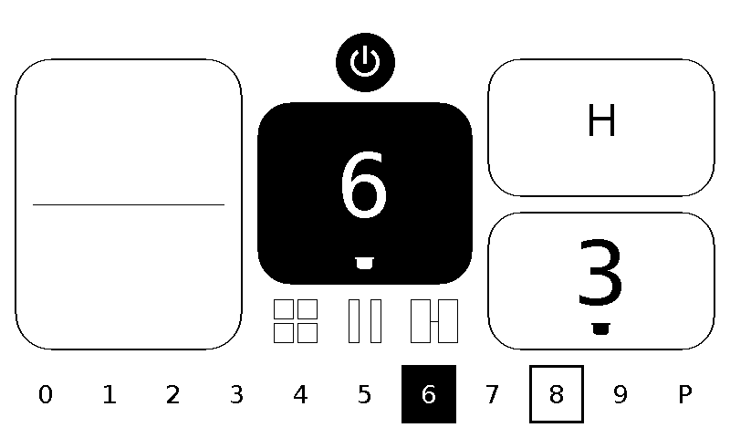
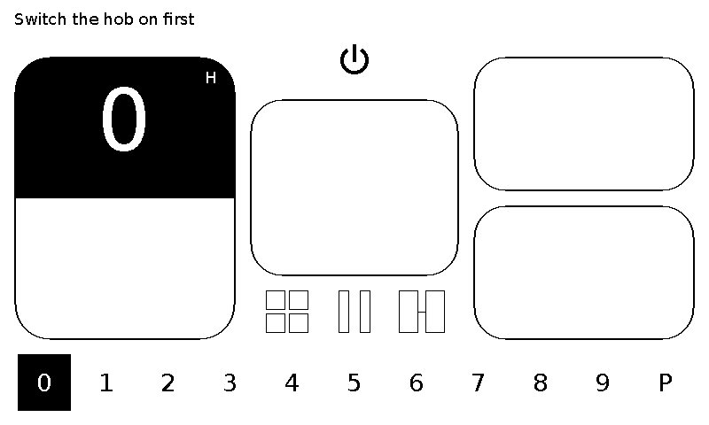
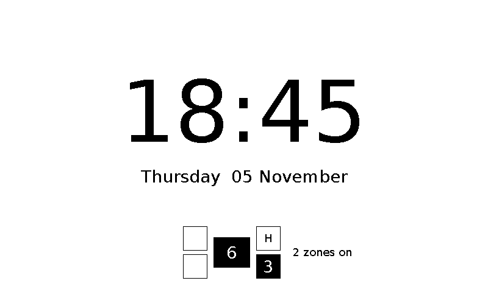

# sticky-hob-remote — e-paper kitchen remote for the IKEA BLIXTSNABB hob

ESPHome firmware for the **Seeed reTerminal Sticky** (800×480 e-paper, touch,
ESP32-S3) that works as a calm, black-and-white kitchen remote for an IKEA
BLIXTSNABB induction hob running the
**blixtsnabb-macs** controller. It also controls a coffee
machine, lights and the extraction hood through Home Assistant.

<p>



</p>

*Rendered from the firmware's own drawing code: cooking, hob off with a notice,
standby clock with live hob status.*

> ⚠️ This remote sends heating commands to a cooking appliance. It never
> replaces the hob's own controls or safety functions, and losing the remote
> never turns the hob off. Do not leave the hob unattended.

## Features

* **Cooktop page:** the five zones laid out as on the hob. Zones at 0 are empty
  outlines, the selected zone is solid black, residual heat shows as "H", and a
  pan icon appears when the hob detects a pan.
* **Instant, honest feedback:** a tapped level shows as an outline right away and
  turns solid only when the hob reports it. After 4 s without confirmation you
  get "Not applied". Displayed levels are never optimistic.
* **Physical keys:** ▲ / ▼ step the selected zone up and down (quick presses
  combine into one command); the grey key wakes the Sticky or goes back one
  page; hold ▲ for 3 s for update mode.
* **Standby glance:** if you walk away while a zone is on or still hot, the clock
  shows a small live hob symbol. It shows "Hob status unknown" rather than
  ever implying "off" without fresh data.
* **Fast and flash-free:** pure black and white with partial refreshes; a full
  refresh only on page changes and every 30 updates.
* **Push link:** the hob sends its state over encrypted UDP about once a second
  and on every change. HTTP polling is only a fallback.
* **Tap for 5 min, then button wake (default):** after use the Sticky stays awake for a few minutes so a tap
  opens it instantly, then deep-sleeps until the grey key is pressed.
* **Battery saver:** deep sleep in standby, woken by the grey key or
  optionally also by a tap on the screen; stays awake while charging. A *Battery current* sensor shows what
  it draws. The always-awake mode lasts about a day on the 750 mAh battery.
* **Home Assistant status:** *Status* (In use / Showing hob / Asleep / …), *Last wake*
  and *Wake reason*; HA keeps the last value while the Sticky sleeps.
* **Also:** kitchen timer (a reminder, not a hob shut-off), coffee, lights and
  hood via Home Assistant, clock with RTC and SNTP, hob discovery over mDNS.
* **Reserved:** multi-zone, pause and bridge buttons are drawn but not wired
  yet; their bus commands have not been captured.

## Requirements

* Seeed reTerminal Sticky
* ESPHome 2026.10.2 or newer
* An IKEA BLIXTSNABB hob with the **blixtsnabb-macs** controller, with its
  optional `packages/sticky-direct.yaml` enabled
* Optional: Home Assistant for the coffee, lights and hood pages

## Installation

### 1. On the hob controller

In the blixtsnabb-macs repository, enable the Sticky package in
`firmware/induction.yaml`:

```yaml
packages:
  sticky_direct: !include packages/sticky-direct.yaml
```

Add `sticky_push_key` to the hob's `secrets.yaml` (any long random string, e.g.
`openssl rand -base64 24`) and flash the hob. Check
`http://<hob>.local/text_sensor/Sticky%20snapshot`: its `tick` should advance
every second.

### 2. On the Sticky

```bash
cp secrets.example.yaml secrets.yaml   # same sticky_push_key as on the hob
esphome run sticky-hob.yaml            # first flash over USB
```

At the top of `sticky-hob.yaml`:

| Substitution | Meaning |
|---|---|
| `hob_name` | ESPHome name of the hob; push data is accepted only from this device |
| `hob_url` | Initial fallback address; Settings → Hob connection saves your choice |
| `timezone`, `clock_step_minutes`, `control_idle_seconds` | Clock and standby behaviour. `clock_step_minutes: 0` (default) shows no clock: the Sticky only wakes when you press the grey key (or tap, if tap wake is on), which gives the longest battery life. With `1`, `5` or `15` it shows a clock and wakes every step to redraw it. |
| `coffee_*`, `light_*`, `hood_*` | Home Assistant entities for the appliance pages |

For the appliance pages, add the Sticky in Home Assistant (Settings → Devices
& services → ESPHome) and enable **Allow the device to perform Home Assistant
actions**.

### 3. Check the link

Open the cooktop page and watch the Sticky's log:

* `Push from hob OK` every 10 s: the push works.
* Only `HTTP snapshot poll` lines: the push does not arrive. Check that the keys
  match, that `hob_name` matches the hob, and that your router does not block
  broadcast traffic between clients. Everything still works over HTTP, just
  slower.

Wireless updates later: hold ▲ for 3 s, or Settings → Enable updates.

## How it talks to the hob

See [docs/HOB-LINK.md](docs/HOB-LINK.md): the push format, the HTTP snapshot
fallback, the REST commands, and the rules the display follows (never show "off"
without fresh data, never replay a command after reconnecting).

The local web server of the hob controller is unauthenticated. Keep it on your
local network and never expose it to the internet.

## Development

```bash
sh tests/run.sh        # host tests for state, layout, push decoding, drawing
```

UI logic lives in `sticky/*.h`; the hardware wiring and scripts are in
`sticky-hob.yaml`. See [CHANGELOG.md](CHANGELOG.md) for the history and
[docs/VALIDATION.md](docs/VALIDATION.md) for what was tested.

## License

MIT, see [LICENSE](LICENSE). Bundled fonts keep their own licenses, see
[NOTICE.md](NOTICE.md).

IKEA and BLIXTSNABB are trademarks of Inter IKEA Systems B.V.; reTerminal is a
trademark of Seeed Technology. This project is not affiliated with or endorsed
by either company.
